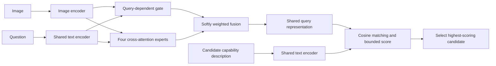

# ARMS: Routing by Model Capabilities for Evolving Vision-Language Model Pools

ARMS is a pre-invocation router for vision-language models (VLMs). Given an
image-text query and a pool of candidate VLMs, it predicts which candidate is
most likely to answer correctly before invoking that candidate. ARMS represents
each candidate with an explicit textual description of its capabilities, fuses
the query through gated cross-attention experts, and scores candidates in a
shared matching space.

This repository contains the ARMS model code, routing examples, the
data-construction pipeline, and compact query-level routing supervision for the
original four-model pool.



## Highlights

- **Multimodal pre-invocation routing:** decisions use both the image and the
  question, without reading the candidate VLM's response first.
- **Explicit model capabilities:** a shared scorer compares each query with a
  structured candidate description instead of a fixed class identifier.
- **Gated cross-attention experts:** query-dependent expert weights capture
  complementary visual and textual evidence.
- **Evolving candidate pools:** incremental and independent strategies add
  previously unseen VLMs without retraining one router over all historical
  candidates.

## Repository Structure

```text
.
├── train.py                    # router model and original training entry point
├── routing.py                  # original experiment evaluation code
├── route_example.py            # independent/cascaded routing example
├── scripts/                    # reconstruction, export, and validation tools
├── data/
│   ├── README.md               # schema and data-release documentation
│   └── original_pool/          # compact routing labels for the paper splits
├── docs/DATA_REPRODUCTION.md  # end-to-end data reconstruction guide
└── results/                    # analysis scripts and generated result files
```

## Public Data Release

The released files cover the four open-source candidates evaluated in the
paper's original-pool setting:

- Qwen2.5-VL-7B-Instruct
- Idefics2-8B
- SmolVLM2-2.2B-Instruct
- Llama-3.2-11B-Vision-Instruct

| Split | Sources | Queries | Candidate outcomes |
|---|---|---:|---:|
| ID train | ALM-Bench, MMT-Bench, MME-RealWorld | 29,626 | 118,504 |
| ID test | MMT-Bench | 3,000 | 12,000 |
| OOD test | VHELM | 7,084 | 28,336 |
| **Total** | 4 public benchmark families | **39,710** | **158,840** |

Each compressed JSONL file contains stable query metadata, a portable image
key, and one binary correctness label per candidate. Questions, images,
reference answers, and raw model generations are not stored in this GitHub
repository. The included scripts reconstruct the public benchmark queries and
join them with the released routing labels.

### Full Dataset Archive

The sanitized, paper-aligned release containing the query records and referenced
images is available through Baidu Netdisk:

- **Archive:** `ARMS_Baidu_Public_Release.zip`
- **Download:** [Baidu Netdisk](https://pan.baidu.com/s/1-MWA29iyZT7UiC0-UqE5lQ?pwd=jah9)
- **Access code:** `jah9`

The archive contains 39,710 queries, 158,840 query-model labels, and 33,613
referenced images. It excludes raw candidate generations, machine-specific
paths, caches, logs, and token, cost, or latency estimates. A manifest and
per-image SHA-256 checksums are included for integrity verification. Users must
also comply with the terms of the upstream benchmark sources listed below.

These files support the paper's 39,710-query original-pool experiments. The
paper reports 56,107 queries across all original-pool and pool-evolution
experiments; the latter use the same routing formulation but are not part of
this public original-pool release.

Validate the release with only the Python standard library:

```bash
python3 scripts/validate_public_dataset.py data/original_pool
```

See [data/README.md](data/README.md) for the schema, file checksums, split
construction, materialization command, and loading example.

## Installation

Python 3.10 or newer is recommended.

```bash
python3 -m venv .venv
source .venv/bin/activate
python -m pip install -r requirements-data.txt
```

Large VLM checkpoints are downloaded separately. Llama-3.2-Vision may require
accepting its provider terms and setting `HF_TOKEN` in the environment. No
credentials are stored in this repository.

## Reconstructing the Data

The public files were built from the same query-level format produced by the
pipeline in `scripts/`:

```bash
python scripts/download_open_datasets.py
python scripts/download_vhelm_v201_instances.py
python scripts/standardize_id_benchmarks.py
python scripts/patch_mmt_answers.py
python scripts/standardize_vhelm.py --download-images
python scripts/download_vlm_models.py
```

Run `scripts/run_vlm_inference.py` once for every candidate and split, merge
the results with `scripts/merge_parse_label_filter.py`, and export the compact
labels with `scripts/export_public_dataset.py`. To train from the public
release, join the compact labels with locally reconstructed queries using
`scripts/materialize_router_records.py`. The complete command sequence is
documented in [docs/DATA_REPRODUCTION.md](docs/DATA_REPRODUCTION.md).

Open-source candidate inference uses bfloat16 weights, each model processor's
chat template, deterministic greedy decoding, and at most 16 newly generated
tokens.

## Data Record Format

Each line is one query with one correctness label per candidate:

```json
{
  "query_id": "...",
  "benchmark": "...",
  "task": "...",
  "language": "...",
  "answer_type": "free_form",
  "image_key": "data/processed/images/...jpg",
  "candidate_labels": {
    "Qwen/Qwen2.5-VL-7B-Instruct": true,
    "HuggingFaceM4/idefics2-8b": false,
    "HuggingFaceTB/SmolVLM2-2.2B-Instruct": false,
    "meta-llama/Llama-3.2-11B-Vision-Instruct": true
  }
}
```

All labels belonging to one query remain in the same split, and every released
query has at least one correct candidate. `image_key` is resolved only after
the corresponding public benchmark data have been reconstructed locally.

## Citation

If you use ARMS or the released routing data, please cite the accompanying
paper. The final BibTeX entry will be added when the publication metadata is
available.

## Third-Party Data

[ALM-Bench](https://huggingface.co/datasets/MBZUAI/ALM-Bench),
[MMT-Bench](https://github.com/OpenGVLab/MMT-Bench),
[MME-RealWorld](https://huggingface.co/datasets/yifanzhang114/MME-RealWorld-Base64),
and [VHELM/HELM](https://github.com/stanford-crfm/helm) remain subject to their
respective upstream terms and licenses. This repository does not redistribute
their questions, answers, or image files. Review the upstream terms before
downloading or redistributing benchmark content.
